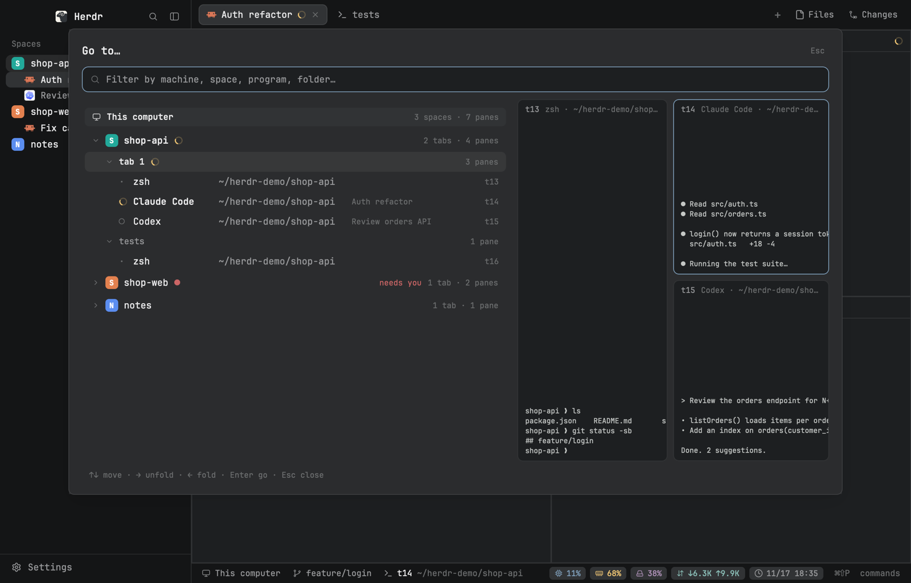
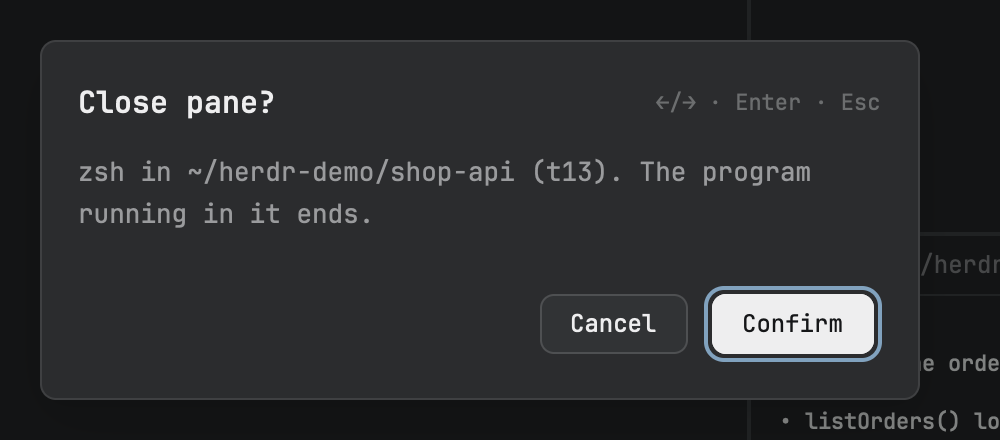
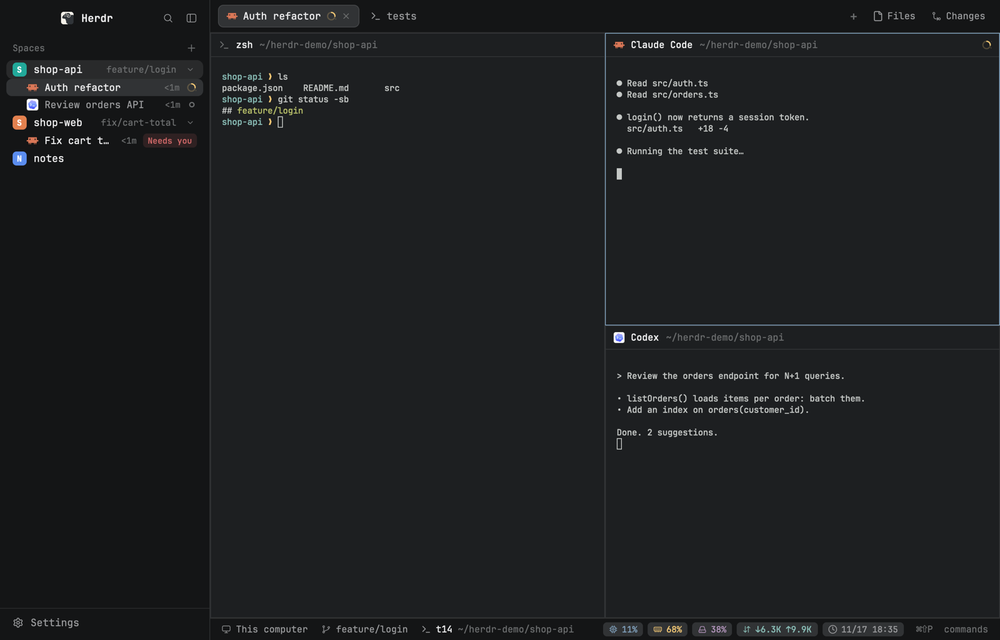
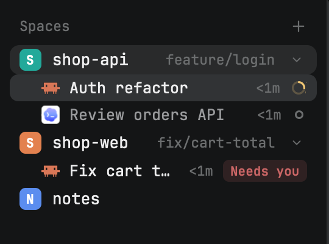
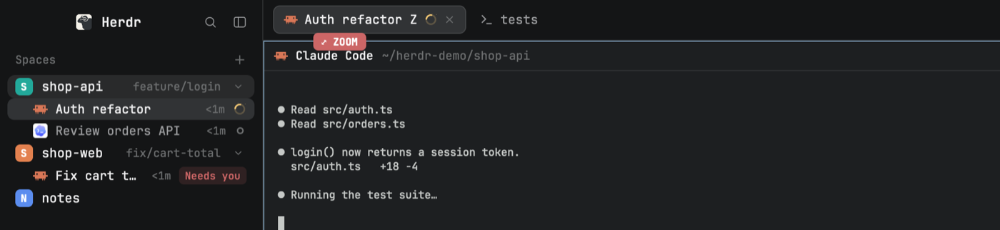

# sashin92-herdr

Herdr 세팅 저장소입니다. tmux에서 쓰던 Alt 단축키를 Herdr에서도 그대로 쓰려고 만들었습니다.

herdr-app 0.1.16, hc 0.1.21 기준입니다.

## 설치

Herdr를 켜 둔 상태에서 실행합니다.

```sh
git clone https://github.com/sashin92/sashin92-herdr.git
cd sashin92-herdr

./install-macos.sh     # macOS
./install-linux.sh     # Linux
```

Windows에서는 PowerShell로 실행합니다.

```powershell
powershell -ExecutionPolicy Bypass -File .\install-windows.ps1
```

- macOS, Linux는 `python3` 필요
- 여러 번 실행 가능 (달라진 것만 변경)
- `git pull` 받은 뒤에도 같은 명령으로 재실행
- Herdr가 꺼져 있었다면 켜고 한 번 더 실행
- 변경 내용 미리 보기: `--dry-run` (Windows는 `-DryRun`)

아래 두 가지는 스크립트가 해 주지 않으니 직접 해야 합니다.

- Jetendard 글꼴 설치
- 원격 머신 등록 (`hc machine add`)

## 단축키

macOS에서는 양쪽 Option이 모두 Alt입니다.

| 키 | 동작 |
|---|---|
| `Alt+h/j/k/l` | pane 이동 |
| `Alt+Shift+h/j/k/l` | pane 크기 조정 |
| `Alt+1`~`9` | space 이동 |
| `Alt+[` `Alt+]` | 이전, 다음 space |
| `Ctrl+1`~`9` | N번째 에이전트로 이동 (사이드바 순서) |
| `Alt+s` | 전체 목록 + 미리보기 |
| `Alt+z` | pane 줌 |
| `Alt+w` | pane 닫기 (확인창) |
| `Cmd+w` | tab 닫기 (확인창) |

`Cmd+w`는 macOS 기준입니다. 다른 운영체제에서는 원래 tab을 닫던 키가 확인창을 띄웁니다.

### 전체 목록 (`Alt+s`)



컴퓨터 > space > tab > pane 순서로 나옵니다. 오른쪽에는 미리보기가 뜨고, tab이나 space 위에서는 분할된 모양 그대로 보여줍니다.

| 키 | 동작 |
|---|---|
| `↑` `↓` 또는 `k` `j` | 이동 |
| `→` `←` 또는 `l` `h` | 펼치기, 접기 |
| `Enter` | 그 space, tab, pane으로 이동 |
| `Esc` | 닫기 |

### 확인창



| 키 | 동작 |
|---|---|
| `←` `→` | Cancel, Confirm 선택 |
| `Enter` | 선택한 쪽 실행 (처음엔 Confirm) |
| `y` | 닫기 |
| `n` `Esc` | 취소 |

## 화면



설치하면 `main-gap0` 레이아웃으로 바뀝니다. 스크린샷은 예시 프로젝트를 띄워 찍은 화면입니다.

| 위치 | 내용 |
|---|---|
| 왼쪽 | space와 에이전트를 한 목록으로 보여주는 사이드바 |
| 위 | tab 줄 (기본보다 얇게, 높이 30px) |
| 가운데 | pane. 사이 간격과 바깥 여백 없이 테두리 선으로만 구분 |
| 아래 | 상태 줄 |

원래 화면으로 돌아가려면 `Cmd+Shift+l`로 레이아웃을 바꾸면 됩니다. 기본 `main` 레이아웃은 그대로 남아 있습니다. 테마는 tomorrow-night, 글꼴은 Jetendard 11입니다.

### 사이드바



space 아래에 그 space의 에이전트가 달려 나옵니다.

- space 줄: 색 아이콘, 이름, 브랜치
- 에이전트 줄: 프로그램 아이콘, 이름, 상태가 바뀐 뒤 지난 시간, 상태
- 상태 표시: 작업 중(돌아가는 원), 대기(빈 원), 확인 필요(`Needs you`)
- 에이전트 줄 클릭으로 그 pane으로 이동
- 지금 보고 있는 space만 펼치고 나머지는 자동으로 접음 (사이드바 맨 위의 접기 버튼으로 켜고 끔)
- space 줄 끝의 화살표로 직접 펼치거나 접기. 직접 펼친 space는 다시 접을 때까지 유지
- 접힌 space와 접힌 컴퓨터 줄에는 에이전트 상태를 점으로 요약 (같은 상태가 둘 이상이면 개수 표시)
- 접힌 space라도 확인이 필요한 에이전트는 표시
- 원격 컴퓨터가 있으면 컴퓨터별로 묶어서 표시
- 맨 아래에는 Settings만 표시 (머신 추가는 Settings에서)

### 상태 줄


지금 보고 있는 space가 있는 컴퓨터 기준으로 보여줍니다. 왼쪽부터 순서대로입니다.

| 항목 | 내용 |
|---|---|
| 컴퓨터 | 이 컴퓨터 또는 원격 컴퓨터 이름. 원격이면 연결 상태도 표시 |
| 브랜치 | 그 space의 git 브랜치 |
| pane | 초점 pane의 터미널 주소(`t14`) |
| CPU, 메모리, 디스크 | 사용률 |
| 네트워크 | 받기, 보내기 속도 |
| 시각 | 그 컴퓨터의 시각 (그 컴퓨터의 시간대 그대로) |

오른쪽 숫자들은 10초마다 갱신되고, macOS와 Linux에서만 나옵니다.

### 줌



`Alt+z`로 줌하면 pane 위에 빨간 ZOOM 배지가 뜹니다.

## 세팅을 고칠 때

`home/` 아래 파일을 고치고 스크립트를 다시 실행합니다.

`~/.config/herdr-app`의 파일을 직접 고치면 다음 실행 때 저장소 내용으로 덮어씁니다. 덮어쓰기 전 파일은 백업으로 남습니다.

## 백업과 복원

스크립트는 파일을 덮어쓸 때마다 원래 파일을 `~/.config/herdr-app/.sashin92-herdr-backup/<시각>/`에 남깁니다. 같은 스크립트로 목록을 보고 복원할 수 있습니다.

```sh
./install-macos.sh --backups                   # 백업 목록
./install-macos.sh --restore                   # 가장 최근 백업으로 복원
./install-macos.sh --restore --backup <이름>   # 고른 백업으로 복원
```

Linux는 `install-linux.sh`에 같은 옵션을 쓰고, Windows는 `-Backups`, `-Restore`, `-Restore -Backup <이름>`입니다.

- 복원 직전 상태도 새 백업으로 보관 (`--restore`를 한 번 더 실행하면 복원 취소)
- 백업에 들어 있는 파일만 복원. 설치로 새로 생긴 파일은 그대로 유지
- `--dry-run`으로 미리 보기 가능

## 되돌리기

1. `Cmd+Shift+l`로 `main` 레이아웃으로 전환
2. `~/.config/herdr-app/keys.json`에서 위 표의 키 삭제, tab 닫기 키는 `tab.close`로 복원
3. `layouts/main-gap0.json`과 `mods/` 아래 이 저장소의 폴더 삭제

화면이 꼬여서 아무것도 안 될 때는 `Ctrl+Alt+Shift+Esc`를 누르면 Herdr가 기본 화면으로 돌려놓습니다.

## 주의

- macOS에서만 사용해 봄. Linux는 임시 폴더에서 스크립트만 확인, Windows는 실행해 본 적 없음
- Windows에서 설정 폴더를 못 찾으면 `-AppHome <폴더>`로 지정
- Herdr 버전이 다르면 일부 mod가 안 맞을 수 있음 (스크립트가 `!`로 표시)

## 라이선스

`spaces-agents`, `pane-picker`, `confirm-choice`, `sidebar-header`, `sidebar-footer`, `status-bar`, `tabs-slim`, `main-gap0` 레이아웃은 Herdr 기본 mod와 레이아웃을 고친 것입니다. Herdr는 Apache 2.0이고 전문은 `LICENSE-Apache-2.0`에 있습니다.
